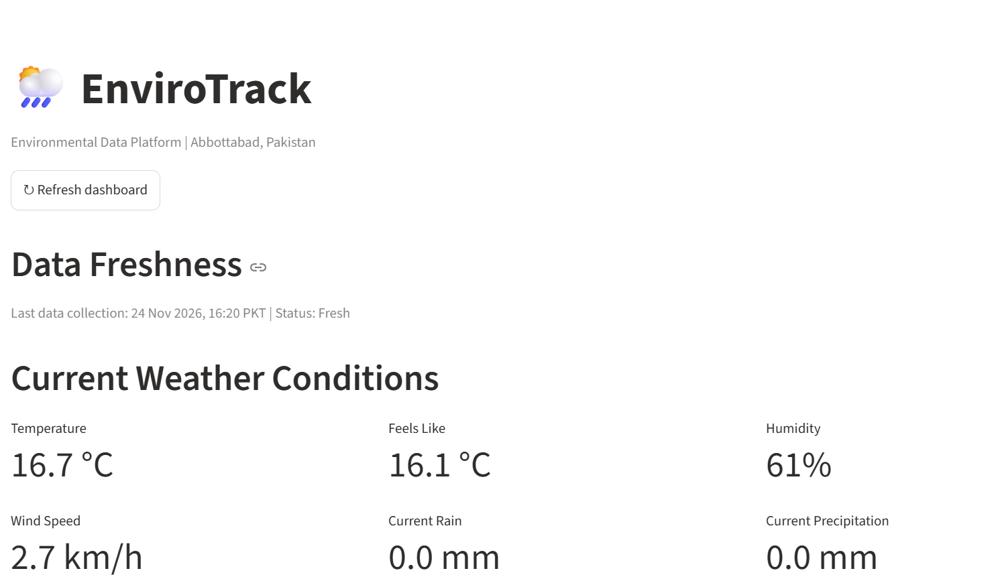

# EnviroTrack — Reliable Environmental Data Platform

# EnviroTrack — Reliable Environmental Data Platform

**Live Dashboard:** [View EnviroTrack](https://envirotrack-abbottabad.streamlit.app/)

**GitHub Repository:** https://github.com/Mugheerik/EnviroTrack

EnviroTrack is a data engineering project that automatically collects, stores, validates, processes, and visualizes weather forecast data for Abbottabad, Pakistan.

The project focuses on building a reliable data pipeline with particular attention to data quality, idempotent processing, raw data preservation, pipeline monitoring, and database integrity.

## Project Overview

EnviroTrack uses the Open-Meteo API as its weather data source.

The pipeline retrieves weather forecasts, preserves the original API responses, transforms hourly measurements into structured PostgreSQL records, and makes the resulting data available through an interactive Streamlit dashboard.

## Dashboard Preview



### Architecture

```text
          Open-Meteo API
                 |
                 v
          Weather Ingestion
                 |
          +------+------+
          |             |
          v             v
     Raw JSON Files   PostgreSQL
                      Raw Data
                          |
                          v
                  Data Validation
                          |
                          v
                  Hourly Processing
                          |
                          v
                  PostgreSQL
                  Hourly Weather
                          |
              +-----------+-----------+
              |                       |
              v                       v
        Data Monitoring         Streamlit Dashboard
```

## Key Engineering Features

- **Automated ingestion:** Retrieves weather forecast data from Open-Meteo.
- **Raw data preservation:** Stores timestamped JSON snapshots for traceability and future analysis.
- **Data validation:** Checks incoming hourly measurements before database loading.
- **Idempotent processing:** Uses database upserts to avoid duplicate records when processing the same forecast timestamps.
- **Data quality monitoring:** Tracks received, accepted, and rejected records.
- **Pipeline observability:** Records execution status, duration, processing metrics, and failures.
- **Data lineage:** Links processing runs to their source raw data records.
- **Failure handling:** Implements request timeouts, retries, and pipeline error tracking.
- **Automated execution:** Uses Windows Task Scheduler to execute the pipeline periodically.
- **Interactive analytics:** Provides current conditions, hourly forecasts, daily forecasts, data freshness, quality metrics, and pipeline history.

## Technology Stack

| Area | Technology |
|---|---|
| Language | Python |
| Data source | Open-Meteo API |
| Database | PostgreSQL |
| Data processing | Pandas |
| Dashboard | Streamlit |
| Visualization | Plotly |
| Database integration | Psycopg |
| Containerization | Docker Compose |
| Dependency management | uv |
| Testing | Pytest |
| Code quality | Ruff |
| Scheduling | Windows Task Scheduler |

## Project Structure

```text
EnviroTrack/
├── data/
│   └── raw/                 # Local raw JSON snapshots
├── logs/                    # Local execution logs
├── sql/                     # Database migrations and reporting views
├── src/
│   └── envirotrack/
│       ├── client.py        # Weather API client
│       ├── config.py        # Application configuration
│       ├── db.py            # Database operations
│       ├── dashboard.py     # Streamlit dashboard
│       ├── ingestion.py     # Raw weather ingestion
│       ├── monitoring.py    # Data freshness monitoring
│       ├── pipeline.py      # Pipeline orchestration
│       └── processing.py    # Validation and transformation
├── tests/                   # Unit and integration tests
├── docker-compose.yml
├── pyproject.toml
├── uv.lock
└── README.md
```

## Running Locally

### Prerequisites

- Python 3.12 or newer
- Docker Desktop
- uv

### 1. Clone the repository

```bash
git clone <YOUR_GITHUB_REPOSITORY_URL>
cd EnviroTrack
```

### 2. Install dependencies

```bash
uv sync
```

### 3. Start PostgreSQL

```bash
docker compose up -d
```

### 4. Initialize the database

Apply the SQL migration files in numerical order from the `sql/` directory.

### 5. Run the pipeline

```bash
uv run python -m envirotrack.pipeline
```

### 6. Launch the dashboard

```bash
uv run streamlit run src/envirotrack/dashboard.py
```

## Testing and Code Quality

Run the test suite:

```bash
uv run pytest -v
```

Run Ruff:

```bash
uv run ruff check src tests
```

## Data Engineering Decisions

**Raw data is preserved:** Original API responses are retained rather than overwritten. This supports traceability and makes it possible to compare forecast snapshots over time.

**Processing is idempotent:** A unique constraint on the source, location, and measurement timestamp supports safe repeated processing through upserts.

**Data quality is measurable:** The pipeline tracks accepted and rejected measurements instead of assuming that successful API responses guarantee valid data.

**Lineage is maintained:** Processing executions reference the raw data records from which they were derived.

**Failures are observable:** Pipeline execution records preserve status and error information for troubleshooting.

## Current Scope and Future Development

The current implementation focuses on a single location: Abbottabad, Pakistan.

Planned improvements include:

- Public dashboard deployment.
- Hosted PostgreSQL infrastructure.
- Cloud-based automated pipeline scheduling.
- Expanded analytical models and reporting.
- Continuous integration and automated testing.
- Improved documentation and architecture diagrams.

## Project Status

Active development.

EnviroTrack is being developed as a practical demonstration of data engineering principles, with an emphasis on reliability, data integrity, observability, and maintainable systems.

**Data Source:** [Open-Meteo](https://open-meteo.com/)